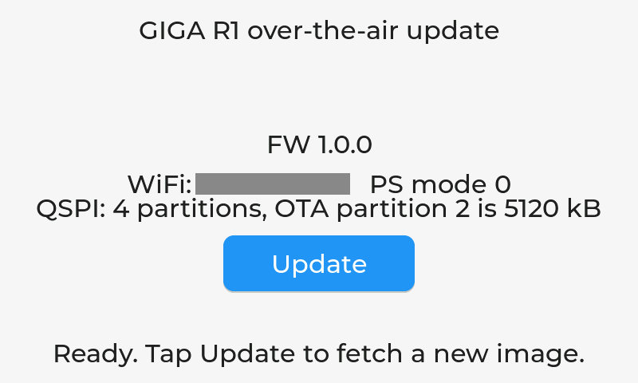
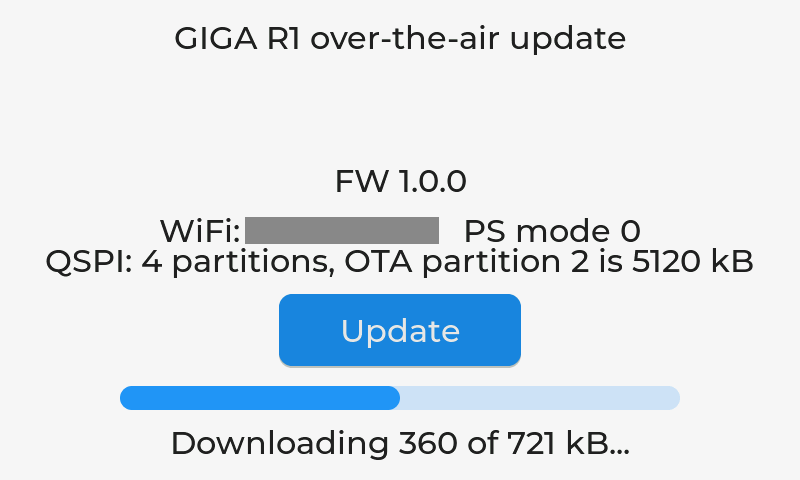
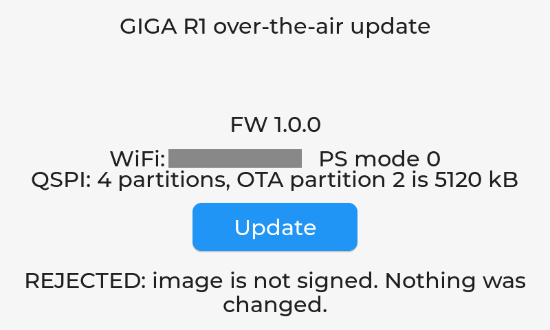
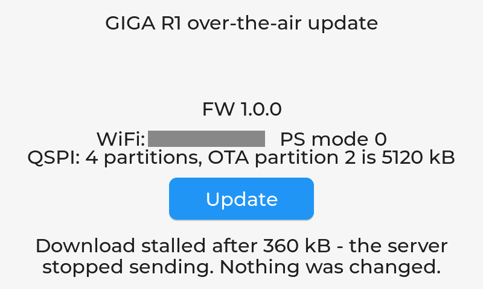

# Giga_OTA

## The Problem
Many of the Arduino and ESP32 devices directly support over-the-air (OTA) firmware updates; the Giga does not.

## The Solution

A minimal demonstration of OTA firmware updates on an **Arduino GIGA R1 WiFi**. This uses a Giga Display Shield to provide user feedback as a minimal example, using LVGL. This uses asymmetric key cryptography to validate firmware image authenticity prior to reflash. Only the public key is stored on the device, so the key cannot be reverse engineered.

A minimal toolset is provided to generate the examples. The examples include a technique for screen capture of the shield so that the user, AI, or future user can see the sample displays and for documentation.

| before                         | after                          |
| ------------------------------ | ------------------------------ |
|  |  |

```bash
python tools/keygen.py                                     # once, ever
python tools/mkota.py sign build/Giga_OTA.ino.bin UPDATE.ota
python tools/serve.py UPDATE.ota                           # prints the URL to paste
python tools/sim_tap.py 400 330 COM12                      # press Update from the PC
python tools/dump_screen.py COM12 after                    # read the result back as a PNG
```

Needs the `Arduino_Portenta_OTA` library, plus `pyserial` and `cryptography`
for the tools.

---

## Background

Searching for GIGA R1 OTA turns up a stale forum answer saying the GIGA is
unsupported, a tutorial written for the Portenta H7, and a packaging toolchain
that does not run on Windows. All three are misleading:

1. **The onboard bootloader already does OTA.** (see 1)
2. **The GIGA is supported** (see 2)
3. **You can skip the documented packaging tools entirely.** (see 3)

---

## 1. The bootloader already supports OTA

The bootloader shipped with the core (`bootloaders/GIGA/bootloader.elf`) contains `getOTABinaryBase()`, a full FATFS and `QSPIFBlockDevice`, and its own strings describe the mechanism:

```
I-Start OTA 0x%X 0x%X 0x%X        I-Sketch updated
I-Booting sketch at 0x%x          E-Failed to locate firmware image, error: %d
/fs/UPDATE.BIN   /fs/UPDATE.BIN.LZSS   /fs/scratch.bin
```

Something puts a file at `/fs/UPDATE.BIN`, something records that an update is
pending, and the bootloader applies it on the next boot.

**`I-Sketch updated` is the only trustworthy confirmation.** `ota.update()`
returning `Error::None` means the update was *recorded*, not *applied*.

### Quad Serial Peripheral Interface (QSPI) flash layout

`/fs/UPDATE.BIN` lives on a FAT filesystem on the Master Boot Record (**MBR partition 2**), in the layout that the core's `QSPIFormat` example creates:

| Partition | Purpose                        | Size | Mount    |
| --------- | ------------------------------ | ---- | -------- |
| 1         | WiFi firmware and certificates | 1 MB | `wlan`   |
| 2         | **OTA**                        | 5 MB | **`fs`** |
| 3         | Provisioning KVStore           | 1 MB | -        |
| 4         | User data                      | 7 MB | `user`   |

If the QSPI has never been partitioned, OTA cannot work and the failure is
opaque - so this sketch reads the partition table at boot and puts the answer
on screen. If it says unpartitioned, run `QSPIFormat` once. **That erases the
QSPI**, including stored WiFi credentials in partition 3.

>Note -  **The MBR's LBA fields are not in 512-byte sectors.**
> `MBRBlockDevice::partition()` takes byte addresses and stores them divided by
> `max(erase_size, 512)` - **4096** here. Assume 512 and every partition reads
> 8x too small, so the 5 MB OTA partition shows up as 640 kB and looks exactly
> like a board needing a reformat. Use `bd->get_erase_size()`. Sanity check:
> the four partitions should be in a 1:5:1:7 ratio whatever unit you divide
> by - if the ratio is right and the numbers look small, it is the unit.

---

## 2. The GIGA *is* supported

Use **`Arduino_Portenta_OTA`**. Its name says Portenta and its README only
discusses the H7, which is why people conclude the GIGA is unsupported:

- `library.properties` lists `mbed_giga`.
- `examples/OTA_Qspi_Flash` has an `#elif defined(ARDUINO_GIGA)` arm.
- `bin2ota.py` lists `GIGA`, magic `0x23410266`.
- Arduino publish a prebuilt image at
  `downloads.arduino.cc/ota/OTA_Usage_Portenta.ino.GIGA.ota` - useful for
  proving the mechanism before you have built anything yourself.

The API is six calls: `isOtaCapable()`, `begin()`, `download()`,
`decompress()`, `update()`, `reset()`. `isOtaCapable()` false means the
bootloader is older than the library wants - update it via
`Examples > STM32H747_System > STM32H747_manageBootloader`.

**`download()` has no progress callback** and blocks for the better part of a
minute. This sketch drives the HTTP GET itself instead, because `send()`
returns once headers are parsed and the body streams through a callback - so
it owns the wait loop and can pump LVGL, count bytes, and read
`Content-Length` for a real denominator.



---

## 3. Skip the packaging tools

The documented path is Arduino's `lzss.py` + `bin2ota.py`. `lzss.py` is a
ctypes shim that loads `./lzss.so`; **there is no `lzss.dll`**, so on Windows
it simply does not run.

Arduino's own shipped GIGA `.ota` is LZSS-compressed, yet
its compression flag - bit 6 of the first word, per the library's own bitfield
in `src/decompress/utility.cpp` - reads **0**:

```
$ python tools/mkota.py info OTA_Usage_Portenta.ino.GIGA.ota
  magic       0x23410266  GIGA
  version     00 00 00 00 00 00 00 40
  decoded     compression=0 ...
```

(`bin2ota.py` writes its flag into byte 7; the struct puts that bit in byte 0.)
The device cannot be reading it, so `decompress()` is unconditional and the
container carries nothing the device needs. **Serve the plain `.bin` and never
call `decompress()`** - the bootloader only cares that `/fs/UPDATE.BIN` is a
valid image.

`tools/mkota.py` builds and inspects `.ota` containers in pure Python if you
want one anyway.

---

## 4. Signing Images

ECDSA P-256 over SHA-256 is verified on the device **before anything is staged**.
The board holds only the public key, so reading a board's flash gives no way to
sign for it.

That property makes the transport somewhat irrelevant. HTTP or HTTPS, a hostile
server, DNS you do not control: an image not signed by the matching private key
is rejected before `/fs/UPDATE.BIN` is touched.



`keygen.py` writes `ota_private_key.pem` (**secret, gitignored, back it up**)
and `ota_pubkey.h` (public, committed, compiled in). Flash the board over USB
once so it carries the key, then sign every image. `mkota.py checksig`
re-verifies using the key parsed out of that header - the one the firmware
actually carries.

The signature is a trailer, so there is one URL and no way to pair an image
with the wrong signature:

```
[ firmware bytes ][ ECDSA signature, DER ][ uint16 siglen ][ GSG1 magic ]
```

Magic last, so the device finds it by seeking to the end. The signature covers
the firmware only, and the verified length tells staging where to stop - the
bootloader never sees the trailer. Costs ~48 kB of flash.

**Rotating the key means USB-flashing every board**, since a board only accepts
images signed by the key it already carries. That is the property doing the
work.

### What signing does not give you

- **No rollback protection.** An older, legitimately signed image can be
  replayed. Signed-and-versioned is stronger than signed; this does the first
  half.
- **No confidentiality** over HTTP. HTTPS adds ~148 kB for the TLS stack.
- **The Content-Length and stall-timeout checks are not security.** They
  protect against dropped connections and crashed servers; an attacker serves
  a complete, correct-length image.
- **`OTA_REQUIRE_SIGNATURE` can be turned off.** It exists for bringing up a
  board before you have a key. Shipping with it off means anyone who can
  answer the URL owns the device.

 **The trigger is local.** An update only starts when the unit commands it. This is somewhat by architecture in where it must be initiated. You can, for example send an MQTT or Red packet to initiate an update, but with a larger security surface to consider.

For signed, verified, rollback-aware updates below the application, the
bootloader already contains a complete MCUboot (`MCUBoot_ECIES_v1`,
`I-Swap type`, `E-Image in the %s slot is not valid!`). Much larger job.

---

## 5. Failing safely

A failed update must leave a working board. `tools/serve_broken.py` declares
the full `Content-Length` then either closes halfway (`truncate`) or holds the
socket open sending nothing (`stall`).



Two guards:

- **A stall timeout**
- **Refusal to stage anything shorter than `Content-Length`**
---

## 6. Gotcha - WiFi sleeps and the Arduino API can't change it on the Giga

Not an OTA topic, but it will spoil a large download.

`whd_wifi_on()` enables PM2 powersave unconditionally on every radio power-up
(`movs r1, #200` then `bl whd_wifi_enable_powersave_with_throughput` in the
shipped `libmbed.a`). After that the radio wakes only on DTIM beacons.
Outbound traffic is unaffected, which is why a board that publishes happily
can still be hard to reach - easy to misdiagnose as a router problem.

There is no `WiFi.setSleep()` on `mbed_giga`, but `WiFi.h` already pulls in
`whd_wifi_api.h`:

```cpp
extern "C" { whd_driver_t cybsp_get_wifi_driver(void); }

whd_interface_t ifp = whd_get_primary_interface(cybsp_get_wifi_driver());
whd_wifi_disable_powersave(ifp);
whd_wifi_get_powersave_mode(ifp, &mode);   // read it back: 0 = off
```

Call it **after** the join, and re-apply on every reconnect - `whd_wifi_on()`
re-arms PM2 each time the radio comes up. Read the mode back rather than
trusting the call; do not try to confirm it with ping times.

---

## 7. What about Zephyr?

The mbed cores are end-of-life and `ArduinoCore-zephyr` 1.0.0 lists the GIGA
R1. **Not yet, if you need a screen** - that core ships no display library and
no LVGL. The only trace of the Display Shield is a devicetree binding for its
DSI bridge (`analogix,anx7625.yaml`); nothing drives it from a sketch.

Most of this transfers: Zephyr's own OTA library writes to the same
QSPI OTA partition and lets *the mbed bootloader* apply it, over plain HTTP.
Same bootloader, same partitions, same hosting. The sketch-side API and the image format change.

---

## Bonus - Verifying from the PC - Screen Grabbing and Interface Automation

| Command        | Does                  | Tool                                 |
| -------------- | --------------------- | ------------------------------------ |
| `D`            | Dumps the framebuffer | `dump_screen.py`, which writes a PNG |
| `P` + `xxxyyy` | Injects a tap         | `sim_tap.py`                         |

`dump_screen.py` needs only `pyserial` and `zlib` - no Pillow. It un-rotates
the framebuffer, because the panel is physically portrait: `Display(800, 480)`
creates a 480x800 LVGL display with `ROTATION_270`.

`sim_tap.py` drives a second LVGL pointer indev, so a tap goes through real
hit-testing and click bubbling.

> **The trap:** LVGL applies `lv_display_rotate_point()` to every indev read.
> The real touch controller reports *raw* panel coordinates. Feeding *logical* coordinates to your own indev rotates them twice and
> taps land nowhere. `simTouchReadCb()` inverts `ROTATION_270` by hand
> (`raw_x = 479 - logical_y`, `raw_y = logical_x`).

---

## Status and Potential to-do's

- [x] Bootloader OTA support, QSPI layout, GIGA as a library target
- [x] `.ota` container decoded; `mkota.py` validated against Arduino's own image
- [x] OTA proven end to end with a self-built image, plain `.bin`, no container
- [x] Signed images verified on-device - unsigned rejected and signed accepted
      in the same boot
- [x] Recovery from an interrupted download, and updatable afterwards
- [x] WHD powersave disable confirmed `2 -> 0`
- [ ] Rollback protection - currently, older valid firmware images can be installed
- [ ] HTTPS path

## License

Copyright (C) 2026 Noah Christian. MIT License.
